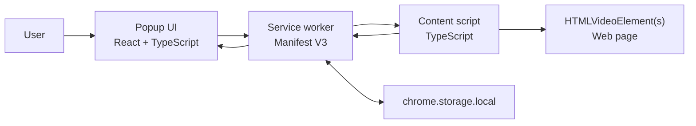

# Playback Unlock — System Design

## 1. System overview

Playback Unlock is a client-side Chrome Extension (Manifest V3). It controls standard HTML5 video elements on webpages the user has allowed it to access. The MVP has no backend; settings are stored with `chrome.storage.local`.

## 2. Components

### Popup UI

- Built with React, TypeScript, and Vite.
- Shows detected videos, selected video state, speed, seek, and A–B loop controls.
- Reads and writes user preferences through extension messaging or the storage API, depending on the operation.
- Displays loading, no-video, access-required, and error states.
- Does not access page DOM directly.

### Content script

- Runs in the allowed webpage context.
- Detects standard HTML video elements and assigns stable IDs for the current document session.
- Tracks video lifecycle and playback state, including dynamically inserted or replaced elements.
- Applies validated speed, seek, and loop commands to the selected video.
- Sends state snapshots and operation results through Chrome extension messaging.
- Observes only playback-related DOM and media state needed by the product.

### Service worker

- Receives requests from the popup and content scripts.
- Routes popup commands to the active tab's content script.
- Reads and writes validated settings in `chrome.storage.local`.
- Handles tab lifecycle and permission-related failures.
- Does not rely on in-memory state surviving suspension; transient state lives in the page/content script, durable preferences in storage.

### Storage

- Uses `chrome.storage.local` for defaults and user preferences.
- MVP does not persist active tab, selected video, current loop, playback history, or page contents.

## 3. Runtime data flow

### Initial popup load

1. Popup requests state for the active tab.
2. Service worker checks tab availability and access.
3. Service worker sends `GET_STATE` to the content script.
4. Content script scans current videos and returns a `TabPlaybackState`.
5. Popup renders the returned state or an access/no-video error state.

### Playback command

1. User selects a control in the popup.
2. Popup sends a typed request with protocol version and request ID.
3. Service worker validates the sender and routes the request to the active tab.
4. Content script validates the payload again and resolves the video ID.
5. Content script applies the action to the video and responds with the resulting state.
6. Service worker returns the response; popup refreshes its view.

### Preference update

1. Popup sends a settings update.
2. Service worker validates the settings against defaults and configured limits.
3. Service worker writes the valid settings to `chrome.storage.local`.
4. On future popup loads, the saved settings are read and applied.

## 4. Component communication

- Use Chrome extension messaging (`runtime.sendMessage`, `tabs.sendMessage`, and their supported response patterns) for cross-context communication.
- Define request and response types in a shared TypeScript module, consistent with `schema.md`.
- Include a message channel identifier, protocol version, request ID, command type, and typed payload.
- Validate both in the service worker and content script; the service worker is not the only validation boundary.
- Use explicit errors for missing tabs, missing content scripts, denied access, invalid commands, and unavailable controls.
- Do not use direct shared-memory assumptions between popup, service worker, and page.

## 5. Video discovery and selection

- Query `document` for standard `HTMLVideoElement` nodes when the content script starts.
- Track DOM changes with a `MutationObserver` to detect inserted and removed video elements.
- Attach media event listeners once per discovered element and remove them when elements are detached.
- Assign a document-session `VideoId`; do not treat it as a permanent cross-navigation identifier.
- Prefer the video currently playing or recently interacted with as the initial selection; otherwise select the most prominent visible video when one can be determined.
- If several candidates remain, return all summaries and let the user choose.
- Never assume that a page has only one video.

## 6. Playback behavior

### Speed

- Set and read `HTMLMediaElement.playbackRate` for supported video elements.
- Validate requested rates against the shared limits in `schema.md`.
- Refresh state after applying the value and report if the effective rate differs from the requested rate.

### Seeking

- Read the media's current time and duration defensively; duration may be unknown or non-finite.
- Use the exposed seekable ranges to determine valid destinations.
- Clamp or reject a destination according to the schema's validation rules, and return the effective position.
- Treat timeline updates as state changes; avoid sending a message on every animation frame when a lower update frequency is sufficient.

### A–B loop

- Keep the current loop in content-script memory, associated with its video ID.
- When playback reaches the end point, seek to the start point if both remain valid.
- Disable and clear the loop if the video is removed, replaced, or its seekable range no longer contains the points.
- Do not persist loop state in the MVP.

## 7. State ownership

| State | Owner | Persistence |
|---|---|---|
| User preferences | Service worker / storage | `chrome.storage.local` |
| Detected video elements | Content script | Current document session |
| Selected video | Content script | Current document session |
| Current loop | Content script | Current document session |
| Popup visual state | Popup UI | Rebuilt from current state responses |

## 8. Permissions and access model

- Use Manifest V3 and request only the permissions needed by the implemented user flows.
- Prefer user-triggered access to the active tab if it supports the desired interaction model.
- Use host permissions only when persistent site access is required; make the scope explicit.
- Handle browser-internal pages and inaccessible frames as unsupported states.
- Do not inject code into frames without the required permission and a defined product need.

## 9. Failure handling

- If no content script responds, show an unavailable or access-required state.
- If a video disappears between detection and command execution, return `VIDEO_NOT_FOUND` and refresh state.
- If the page changes the player, rescan and discard stale element references.
- If storage is missing or invalid, restore validated defaults.
- If the service worker is restarted, reconstruct state from the tab/content script and storage rather than relying on old in-memory values.
- Errors returned to the UI should be actionable and must not include sensitive page content.

## 10. Security and privacy boundaries

- The content script handles page DOM as untrusted input and limits access to video playback state.
- Validate messages in both sender and receiver contexts.
- Keep user data local; the MVP makes no network requests and has no backend.
- Do not use remote executable code or `eval`.
- Keep permissions narrow and document each permission's feature purpose.
- Follow `security.md` for detailed security and agent guardrails.

## 11. Build and deployment shape

- React popup and extension pages are bundled with Vite.
- Background service worker and content script are separate build entry points.
- Build output includes a Manifest V3 `manifest.json` at the package root.
- The output directory is loaded as an unpacked extension for local development.
- The production package contains only required runtime assets and locally bundled code.

## 12. Design decisions

- **No backend in MVP:** There is no account, cloud sync, or server-side processing requirement.
- **HTML5-first support:** The baseline integration uses the browser's standard media element. Site-specific players require separate compatibility work.
- **Popup-first controls:** The popup is the initial UI; a floating controller is deferred to a later version.
- **Typed messages:** Shared schemas reduce mismatch between popup, worker, and content script.
- **Re-query dynamic state:** Page video elements can change, so the extension does not treat an earlier scan as permanent truth.

## 13. Main trade-offs

- **Popup vs. floating controller:** A popup is simpler and permission-light, but closes when focus leaves it. The floating controller can stay near the video but adds UI injection and lifecycle complexity.
- **Active-tab access vs. host permissions:** Active-tab access narrows standing permissions but may require user action each time. Host permissions support a smoother experience but broaden access.
- **Polling vs. media events:** Media events are efficient for state changes, while limited polling can help refresh popup state. Use event-driven updates where possible and avoid high-frequency polling.
- **Generic support vs. site adapters:** Standard HTML5 handling covers common players; adapters can improve compatibility but add per-site maintenance.
